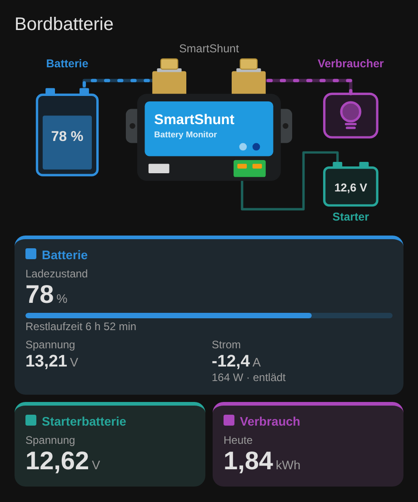

# Victron Shunt Card

Lovelace-Karte für Home Assistant, die die aktuellen Leistungsdaten eines
Victron SmartShunt (oder BMV) anzeigt:

| Wert | Konfigurationsschlüssel |
|---|---|
| Ladezustand (SOC) | `soc` |
| Strom | `current` |
| Spannung | `voltage` |
| Spannung Starterbatterie | `starter_voltage` |
| Verbrauch heute | `consumption_today` |

Oben zeigt eine schlichte Grafik Batterie → SmartShunt → Verbraucher sowie
die Starterbatterie am Aux-Eingang. Der Füllstand der Batterie entspricht dem
SOC, die Kabel sind animiert (Richtung: Laden/Entladen, Geschwindigkeit
abhängig vom Strom). Darunter stehen die Werte in drei farbigen Gruppen,
passend zur Grafik:

- **Blau – Batterie:** SOC mit Balken, Spannung, Strom mit Leistung und Status „lädt“ / „entlädt“, optional Restlaufzeit
- **Türkis – Starterbatterie:** Spannung
- **Lila – Verbrauch:** Verbrauch heute

Batterie und Starterbatterie werden orange bzw. rot, sobald die Warn- bzw.
kritische Schwelle unterschritten ist (die Fehler-LED am Shunt blinkt dann).



## Installation über HACS

1. HACS öffnen → Menü (⋮) → **Benutzerdefinierte Repositories**.
2. `https://github.com/abcklaus/victron-shunt-card` eintragen, Typ **Dashboard** (früher „Lovelace“) wählen.
3. „Victron Shunt Card“ suchen und herunterladen.
4. Browser neu laden (Cache leeren).

HACS legt die Ressource `/hacsfiles/victron-shunt-card/victron-shunt-card.js`
automatisch an.

### Manuell

`dist/victron-shunt-card.js` nach `/config/www/` kopieren und unter
*Einstellungen → Dashboards → Ressourcen* als JavaScript-Modul
`/local/victron-shunt-card.js` hinzufügen.

## Konfiguration

Die Karte lässt sich komplett im grafischen Editor einrichten
(„Karte hinzufügen“ → „Victron Shunt Card“). Als YAML:

```yaml
type: custom:victron-shunt-card
name: Bordbatterie
soc: sensor.smartshunt_state_of_charge
voltage: sensor.smartshunt_voltage
current: sensor.smartshunt_current
starter_voltage: sensor.smartshunt_starter_voltage
consumption_today: sensor.batterie_verbrauch_heute
time_remaining: sensor.smartshunt_time_remaining
```

### Alle Optionen

| Option | Typ | Standard | Beschreibung |
|---|---|---|---|
| `name` | string | `Victron SmartShunt` | Titel; leer = kein Kopfbereich |
| `soc` | entity | – | Ladezustand (%) |
| `voltage` | entity | – | Spannung der Batterie (V) |
| `current` | entity | – | Strom (A); positiv = Laden, negativ = Entladen |
| `starter_voltage` | entity | – | Spannung der Starterbatterie (Aux-Eingang) |
| `consumption_today` | entity | – | Verbrauch heute (z. B. kWh oder Ah) |
| `power` | entity | – | Leistung (W). Ohne Angabe: `voltage × current` |
| `time_remaining` | entity | – | Restlaufzeit (s, min oder h); wird beim Entladen angezeigt |
| `soc_warning` | number | `30` | SOC ab diesem Wert orange |
| `soc_critical` | number | `15` | SOC ab diesem Wert rot |
| `starter_warning` | number | `12.2` | Starterbatterie ab dieser Spannung orange |
| `starter_critical` | number | `11.8` | Starterbatterie ab dieser Spannung rot |
| `max_current` | number | `100` | Strom, bei dem die Fluss-Animation am schnellsten läuft |
| `show_diagram` | boolean | `true` | Grafik anzeigen |

Für 24-V-Starterbatterien die Schwellen entsprechend anpassen (z. B. `24.4` / `23.6`).

Nicht konfigurierte Werte werden ausgeblendet; nicht verfügbare Sensoren
erscheinen als „—“. Ein Klick auf einen Wert (oder auf ein Element der Grafik)
öffnet den Verlauf der Entität. Die Nachkommastellen folgen der in Home
Assistant eingestellten Anzeigegenauigkeit.

Die Farben lassen sich z. B. mit card-mod über die CSS-Variablen
`--shunt-battery`, `--shunt-starter`, `--shunt-consumer` und `--shunt-device`
anpassen.

## Woher kommen die Sensoren?

Die Karte zeigt nur vorhandene Home-Assistant-Sensoren an. Den SmartShunt
bekommt man z. B. so in Home Assistant:

- **Bluetooth:** die Integration *Victron BLE* (Instant Readout; Schlüssel aus
  der VictronConnect-App unter *Produktinfo → Instant Readout Details*).
- **VE.Direct:** per USB-Kabel an Venus OS / Cerbo GX (Modbus-TCP-Integration)
  oder per ESP32 mit ESPHome und der `victron`-Komponente.

Der Aux-Eingang des Shunts muss in VictronConnect auf **Starterbatterie**
eingestellt sein, damit die Spannung der Starterbatterie geliefert wird.

### Verbrauch heute

Der SmartShunt liefert keinen Tageswert. Am einfachsten wird er in Home
Assistant aus der Leistung gebildet – erst die Entladeleistung, dann daraus
Energie, dann ein Tageszähler:

```yaml
template:
  - sensor:
      - name: Batterie Entladeleistung
        unit_of_measurement: W
        device_class: power
        state_class: measurement
        state: "{{ [0, -(states('sensor.smartshunt_voltage') | float(0) * states('sensor.smartshunt_current') | float(0))] | max }}"

sensor:
  - platform: integration
    source: sensor.batterie_entladeleistung
    name: Batterie Entladeenergie
    unit_prefix: k
    method: left
    round: 3

utility_meter:
  batterie_verbrauch_heute:
    source: sensor.batterie_entladeenergie
    cycle: daily
```

`sensor.batterie_verbrauch_heute` dann als `consumption_today` eintragen.

## Entwicklung

```bash
npm run build   # erzeugt dist/victron-shunt-card.js
```

Quellcode liegt in `src/`. Für ein Release einen
GitHub-Release mit Tag `vX.Y.Z` anlegen – der Workflow baut die Datei und
hängt sie an. HACS bietet dann diese Version zur Installation an.
